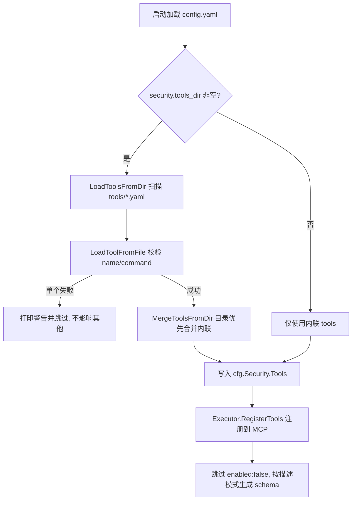

# CyberStrikeAI 工具列表维护指南（中文）

> 本文说明 CyberStrikeAI 的“工具列表”从何而来、如何加载注册、以及日常维护（新增/修改/停用）的操作方式。
> 结论先行：工具列表不是单一来源，而是**四类工具汇总后统一注册到 MCP**。

---

## 1. 工具列表的四个来源

所有来源最终都会合并进 `config.Security.Tools`（类型 `[]ToolConfig`），再由 `Executor.RegisterTools` 注册为 MCP 工具。

| 来源 | 位置 | 说明 |
|------|------|------|
| **① 目录工具（主要）** | `tools/*.yaml`（由 `security.tools_dir` 指定，默认 `tools`） | 启动时扫描所有 `.yaml` / `.yml`，每个文件定义一个工具 |
| **② 内联工具** | `config.yaml` 的 `security.tools` 数组 | 作为补充；与目录工具同名时，**目录工具优先** |
| **③ 内置工具** | Go 代码注册（如 `read_file`、`grep`、`glob`、`tool_search` 等） | 不来自 YAML；在设置页按名称开关 |
| **④ 外部 MCP 工具** | `external_mcp.servers` | 动态引入第三方 MCP server 提供的工具，拥有独立开关 |

---

## 2. 加载与注册链路



流程要点：

1. **启动加载**：`config.Load(path)` 时，若 `Security.ToolsDir != ""`，则 `ResolveToolsDir` 解析绝对路径后调用 `MergeToolsFromDir`，结果写回 `cfg.Security.Tools`。
2. **目录扫描**：`LoadToolsFromDir` 用 `os.ReadDir` 遍历目录，只处理 `.yaml` / `.yml` 文件，逐个调用 `LoadToolFromFile`。
3. **单文件校验**：`LoadToolFromFile` 解析 YAML 并校验 `name`、`command` 非空；**单文件失败仅打印警告并跳过，不影响其他工具，也不阻塞启动**。
4. **合并策略**：`MergeToolsFromDir` 以目录工具为基础，内联工具按名称补充，**同名时目录工具覆盖内联工具**。
5. **注册**：`Executor.RegisterTools` 遍历 `Security.Tools`，跳过 `enabled: false` 的项，根据 `tool_description_mode` 选择短/详细描述，并通过 `buildInputSchema` 生成参数 schema 后注册为 MCP Tool。

---

## 3. 关键代码位置

| 职责 | 文件 | 函数 |
|------|------|------|
| 启动加载合并 | `internal/config/config.go` | `config.Load`（tools_dir 分支）、`MergeToolsFromDir` |
| 目录扫描 | `internal/config/config.go` | `LoadToolsFromDir` |
| 单文件解析校验 | `internal/config/config.go` | `LoadToolFromFile` |
| 路径解析 | `internal/config/config.go` | `ResolveToolsDir` |
| 热重载 | `internal/config/config.go` | `ReloadSecurityToolsFromDir` |
| 注册到 MCP | `internal/security/executor.go` | `Executor.RegisterTools` |
| 热重载触发入口 | `internal/handler/config.go` | 应用配置（ApplyConfig）处 |
| 内置工具开关 | `internal/handler/config.go` | `internalToolMap` 处理逻辑 |

---

## 4. 维护操作与生效方式

| 操作 | 做法 | 生效方式 |
|------|------|----------|
| 新增工具 | 在 `tools/` 下新建 `xxx.yaml` | 设置页「应用配置」触发热重载，**无需重启** |
| 修改工具 | 编辑对应的 `tools/xxx.yaml` | 同上 |
| 停用工具 | 将 `enabled` 设为 `false`，或删除/重命名文件 | 同上 |
| 调整描述模式 | `security.tool_description_mode: short` / `full` | 控制暴露给 AI 的描述来源（`short` 更省 token） |

热重载流程（应用配置时）：

```
ReloadSecurityToolsFromDir 重新扫描目录
  → MergeToolsFromDir 重新合并
  → mcpServer.ClearTools() 清空旧工具
  → Executor.RegisterTools 重新注册
```

> 注意：`tools/README.md` 中写的是“保存后重启服务生效”，但代码实际已支持设置页热重载。
> 只有当直接手改 `config.yaml` 且**不经过设置页应用**时，才需要重启进程。

---

## 5. 单个工具 YAML 维护规范

### 5.1 顶层字段

| 字段 | 必填 | 类型 | 说明 |
|------|------|------|------|
| `name` | ✅ | string | 工具唯一标识，建议小写字母/数字/短横线 |
| `command` | ✅ | string | 实际执行的命令，需在 PATH 或写绝对路径 |
| `enabled` | ✅ | bool | 是否注册到 MCP；`false` 时忽略 |
| `description` | ✅ | string | 详细描述，支持多行 Markdown |
| `short_description` | 可选 | string | 20–50 字摘要，用于工具列表、减少 token |
| `args` | 可选 | string[] | 固定参数，按顺序 prepend 到命令行 |
| `parameters` | 可选 | array | 运行时可配置参数列表 |
| `arg_mapping` | 可选 | string | 参数映射模式（`auto`/`manual`/`template`），默认 `auto` |

### 5.2 参数格式（`parameters[].format`）

- `flag`：标志参数，如 `-u http://example.com`
- `positional`：位置参数，按 `position` 顺序添加
- `combined`：组合格式，如 `--level=3`
- `template`：自定义模板，如 `{flag} {value}`

### 5.3 特殊参数

- `additional_args`：传递未定义的高级选项，按空格分割后追加到命令末尾。
- `scan_type`：部分工具（如 nmap）用于覆盖默认扫描类型参数。

### 5.4 校验与调试

- 加载时自动校验必需字段与参数格式；错误配置被跳过并输出警告，不影响其他工具。
- 可用 `go run cmd/test-config/main.go` 测试配置加载。

---

## 6. 当前工程状态

- `config.yaml` 中 `security.tools_dir` 默认为 `tools`。
- 因此 `tools/` 目录下的那批 YAML（如 `nmap.yaml`、`sqlmap.yaml`、`nuclei.yaml` 等）即为当前的工具列表来源。
- 新增工具：把新的 `.yaml` 放入 `tools/`，再到页面「设置 → 应用配置」即可热加载。

---

## 7. 相关文档

- 工具配置字段与模板详解：`tools/README.md`
- 本地运行指南：`docs/LOCAL_DEV_SETUP_CN.md`
- 项目架构概览：`docs/ARCHITECTURE_CN.md`
